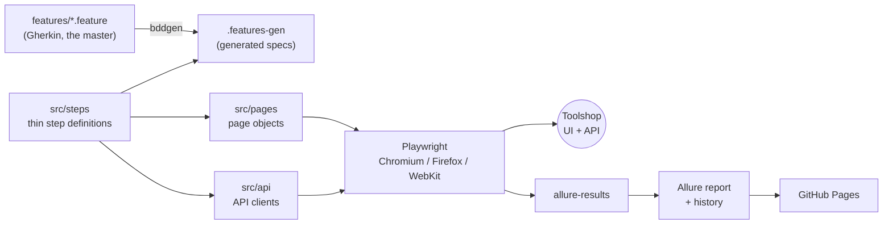

# Toolshop Test Automation: Playwright + Cucumber BDD (Gherkin)

[](https://github.com/im-mdsr/playwright-js/actions/workflows/ci-pr.yml)
[](https://github.com/im-mdsr/playwright-js/actions/workflows/nightly.yml)


UI, API and hybrid test automation for [Practice Software Testing (Toolshop)](https://practicesoftwaretesting.com), written as Gherkin features and executed with Playwright through [`playwright-bdd`](https://github.com/vitalets/playwright-bdd). Reports are built with Allure 3. The suite runs the same way on your machine or in Docker, and in CI on every pull request and every night.

**Live Allure report:** <https://im-mdsr.github.io/playwright-js/> (published by the nightly workflow; it appears after the first successful run with GitHub Pages enabled).

## Run it

```bash
npm ci
npx playwright install
npm test                              # all features, Chromium + Firefox + WebKit
npm run report:allure && npm run report:allure:open
```

Prefer a clean, reproducible environment? Use Docker instead; nothing but Docker is needed.

```bash
npm run docker:test                   # whole suite in the official Playwright image
npm run docker:smoke                  # smoke scenarios, Chromium only
```

| Goal                   | Local                                                   | Docker                              |
| ---------------------- | ------------------------------------------------------- | ----------------------------------- |
| Everything             | `npm test`                                              | `npm run docker:test`               |
| Smoke                  | `npm run test:smoke`                                    | `npm run docker:smoke`              |
| One browser            | `npm run test:chromium` (`:firefox`, `:webkit`)         | `docker compose run --rm tests ...` |
| Update visual baseline | `npx playwright test --grep @visual --update-snapshots` | `npm run docker:visual:update`      |

Settings come from `.env` (copy `.env.example`); the defaults point at the public site and its published demo customer. Requires Node.js 22 or newer.

## What is tested

66 test cases, all automated (see [docs/test-case-matrix.md](docs/test-case-matrix.md)):

| Area                                  | Cases | Notes                                                                  |
| ------------------------------------- | ----- | ---------------------------------------------------------------------- |
| Authentication                        | 9     | login, logout, registration, forgot password (UI + API)                |
| Catalog, product, cart                | 20    | search, filters, sorting, product page, cart totals and persistence    |
| Checkout, account, favorites, contact | 12    | five payment methods, address validation, invoices, favorites, contact |
| API                                   | 10    | status codes, auth, negative cases, JSON schema validation (Ajv)       |
| Accessibility                         | 4     | axe-core scans of home, product, login and cart                        |
| Visual                                | 3     | header, footer and first product card (Chromium)                       |
| Resilience                            | 3     | the products request mocked to fail or return nothing                  |
| Known defects (declared)              | 5     | real site defects, asserted as correct behaviour and expected to fail  |

## Measured results

Measured on 2026-10-30 against the live site, retries off, from a laptop (Windows 10). A full pass is 237 scenario runs: 95 on Chromium (includes API and visual) and 71 each on Firefox and WebKit.

| Run                                                                | Runs | Unexpected failures | Failure rate | Wall time |
| ------------------------------------------------------------------ | ---- | ------------------- | ------------ | --------- |
| Firefox, 1 full pass                                               | 71   | 0                   | 0%           | 3.6 min   |
| WebKit, 1 full pass                                                | 71   | 0                   | 0%           | 3.5 min   |
| Chromium, 3 passes at once (`--repeat-each=3`), before API retries | 285  | 12                  | 4.2%         | 12.5 min  |
| Chromium, 3 passes at once, after API retries                      | 285  | 5                   | 1.8%         | 11.1 min  |

How to read this:

- The Chromium rows run three copies of every scenario at the same time against one shared demo site, which is much harsher than a normal run.
- The remaining failures are different tests each time and all are timeouts or dropped connections from the site (15 s or 60 s limits). They are not a fault in one scenario. The first run's failures also included dropped connections in API helpers; those are what the added retries address (`GET` requests and adding to a new cart).
- The flake target was under 1%. **Chromium under this load does not meet it (1.8%)**; a normal single pass is closer (the previous full run had 2 timeouts in 237). The nightly report shows the real trend over time, with CI retries marked as "flaky".

## How it fits together



| Layer            | Where                                                    |
| ---------------- | -------------------------------------------------------- |
| Gherkin features | `features/`                                              |
| Step definitions | `src/steps/`                                             |
| Page objects     | `src/pages/` (locators via the site's `data-test` ids)   |
| API clients      | `src/api/`                                               |
| Fixtures         | `src/fixtures/` (lazy; pages, clients, `newUser`, `ctx`) |
| Schemas, data    | `src/schemas/`, `src/utils/`, `src/data/`                |

## CI

| Workflow                                     | When                          | What                                                                                              |
| -------------------------------------------- | ----------------------------- | ------------------------------------------------------------------------------------------------- |
| [ci-pr.yml](.github/workflows/ci-pr.yml)     | pull requests, push to `main` | lint, format check, smoke scenarios on Chromium                                                   |
| [nightly.yml](.github/workflows/nightly.yml) | 02:00 UTC daily, on demand    | all scenarios, 3 browsers × 3 shards, merged Allure report published to GitHub Pages with history |

## Design decisions

- [ADR 0001: page objects, API clients and fixtures behind Gherkin steps](docs/adr/0001-pom-and-fixtures.md)
- [ADR 0002: seed data through the API and sign in with a token](docs/adr/0002-api-seeding-and-token-sign-in.md)
- [ADR 0003: Allure reports published to GitHub Pages](docs/adr/0003-allure-and-ci-reporting.md)
- [Test strategy](docs/test-strategy.md), including what is out of scope
- [Known site defects](docs/known-defects.md), declared and tested rather than hidden

## Skills shown

Playwright (JavaScript), BDD/Gherkin with `playwright-bdd`, page object model and custom fixtures, API testing and JSON schema validation, hybrid API + UI tests, data-driven scenario outlines, accessibility (axe-core), visual regression, network mocking, parallel execution and sharding, GitHub Actions CI/CD, Allure reporting with history, Docker, ESLint + Prettier + Husky, test documentation (Jira Xray format).

## More

- [CONTRIBUTING.md](CONTRIBUTING.md): how to add a test
- [CHANGELOG.md](CHANGELOG.md)
- [PROJECT_STATUS.md](PROJECT_STATUS.md), [TEST_AUTOMATION_PLAN.md](TEST_AUTOMATION_PLAN.md), [DISCOVERY_FINDINGS.md](DISCOVERY_FINDINGS.md)
- [docs/test-cases/Toolshop_Test_Cases_Xray.xlsx](docs/test-cases/Toolshop_Test_Cases_Xray.xlsx), regenerated with `npm run export:testcases`

Licensed under the [MIT License](LICENSE).
